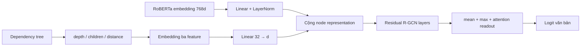

# Báo cáo cải tiến đã được công nhận: R-GCN V3 Baseline / V1_swap

## 1. Phạm vi báo cáo

Báo cáo này chỉ ghi nhận **R-GCN V3 Baseline**, tức checkpoint lịch sử
`Quang_v3_V1_swap` / `p3fin_V1_swap`, là cải tiến chính thức của nhóm. Các
checkpoint Table 3–4 tương ứng dùng năm seed 2021–2025, huấn luyện trên HC3,
`struct_mode=low`, `readout=pool3`, và `aug=swap`.

Các hướng MeanLogit, Corrected Structural Mapping, Class-Preserving Swap,
Structure-Guided Restricted Embeddings, CMixStyle và R-Drop không phải đóng
góp được công nhận trong báo cáo này. Chúng không được dùng làm bằng chứng
cho hiệu quả của V3 Baseline.

Nền tảng so sánh thực nghiệm là GCN do nhóm tự train, không dùng các con số
trong paper làm baseline chính. Mô tả benchmark và các kết quả V3 đã tổng hợp
có ở [Kết quả V3 Table 3–4](../result/V3_q/TongHopKetQua_V3_Quang_Table3_Table4.md)
và [so sánh Table 4 V3–GCN](../result/Result_v3/Table4_V3_Results.md).

## 2. V3 Baseline gồm những gì?

V3 bắt đầu từ đồ thị phụ thuộc cú pháp tạo bằng `building_graph.py`. Mỗi token
là một node với embedding RoBERTa 768 chiều; cạnh cú pháp mặc định đi từ
**dependent → head** và mang relation ID của dependency. Mô hình dùng toàn bộ
các relation ID trong message passing R-GCN, sau đó phân loại ở mức văn bản.

Các thay đổi cốt lõi của V3 Baseline là:

| Thành phần | Cơ chế trong V3 Baseline | Vai trò |
| --- | --- | --- |
| R-GCN quan hệ | Ma trận theo relation được biểu diễn bằng basis decomposition và chuẩn hóa theo số cạnh cùng đích/relation. | Phân biệt loại phụ thuộc khi truyền thông tin thay vì gộp mọi cạnh như GCN. |
| Backbone ổn định | Chiếu `768 → d`, LayerNorm, residual R-GCN, GELU, dropout đầu vào và dropout tầng. | Giữ biểu diễn node ổn định khi đồ thị có số node/cạnh khác nhau. |
| **Structural Features** | Mã hóa depth, số children và dependency-distance của từng node; cộng vào biểu diễn node trước R-GCN. | Cung cấp trực tiếp vai trò cây mà message passing cục bộ khó suy ra ổn định. |
| **Syntax-Aware Swap** | Hoán đổi embedding node theo nhóm relation dependency, giữ nguyên topology đồ thị. | Huấn luyện mô hình ít phụ thuộc vào một vài embedding từ đơn lẻ. |
| Huấn luyện/chọn checkpoint | AdamW, warmup + cosine, gradient clipping, EMA; chọn theo tổng validation loss sạch và loss của validation-swap proxy. | Chọn checkpoint theo tín hiệu robustness ở validation, không theo Table 2–4 test. |
| Readout | Ghép mean pooling, max pooling và attention pooling rồi đưa qua MLP (`pool3`). | Tổng hợp cả tín hiệu phổ biến, tín hiệu mạnh cục bộ và tín hiệu được attention ưu tiên. |

V3 Baseline có khoảng 4.59 triệu tham số ở cấu hình checkpoint được đánh giá.

## 3. Structural Features

### 3.1. Vấn đề mà Structural Features giải quyết

R-GCN đã biết loại relation của cạnh, nhưng tự nó không nhận một nhãn rõ ràng
rằng node đang ở độ sâu bao nhiêu, có bao nhiêu node con, hay dependency head
cách token đó bao xa trong chuỗi. Các đại lượng này có thể mang tín hiệu về
cấu trúc câu và cách văn bản được tạo, đồng thời giúp mô hình không phải suy
luận hoàn toàn từ nhiều lượt message passing.

V3 vì thế tạo feature cấu trúc cho **mỗi node** trước backbone. Đây là một
nguồn thông tin bổ sung cho embedding RoBERTa, không thay thế embedding hoặc
thay đổi nội dung văn bản.

### 3.2. Cách tạo parent forest trong checkpoint Baseline

Trong schema legacy `low` của checkpoint V3, hàm `fwd_mask()` chọn các cạnh có
relation ID `< R // 2`; self-loop (`src == dst`) bị loại trước khi tạo parent.
Với `R=51`, nhóm này là ID 0–24. Mỗi node nguồn của cạnh đã chọn nhận một
parent là node đích. Node không có parent được xem là root; một văn bản có
nhiều câu vì vậy có thể có nhiều root.

Đây là cách mapping lịch sử mà V3 Baseline đã dùng để tạo chính các checkpoint
được báo cáo. Nó cần được phân biệt với message passing: R-GCN vẫn nhận toàn
bộ edge/relation trong batch, không chỉ nhóm 0–24.



### 3.3. Ba feature node và lượng tử hóa

Hàm `struct_features()` tạo ba số nguyên cho từng node:

| Feature | Cách tính | Bucket đưa vào embedding |
| --- | --- | --- |
| Depth | Số parent phải đi qua để tới root trong parent forest. | `min(depth, 31)`; giới hạn an toàn lúc duyệt là 64 bước. |
| Children | Số node chọn node hiện tại làm parent. | `min(children, 11)`. |
| Parent distance | `abs(token_index − parent_index)`; root có khoảng cách 0. | `floor(log2(distance + 1))`, giới hạn 7. |

Ba bucket lần lượt được embedding kích thước 16, 8 và 8. Vector 32 chiều sau
khi nối được chiếu sang hidden dimension `d`, rồi cộng với node state sau
`proj` và `LayerNorm`. Sau phép cộng, mô hình dùng GELU và các residual R-GCN
layers. Thiết kế này giúp structural signal đi vào mọi layer sau đó, thay vì
chỉ được dùng tại readout.

`GraphSet` cũng tính tám graph-level statistics, gồm số node, số root, độ sâu
trung bình/tối đa, chiều cao cây và thống kê children. Tuy nhiên checkpoint
V3 Baseline được báo cáo có `gfeat=0`; các graph-level statistics này **không
được nối vào readout**. Đóng góp Structural Features của Baseline vì vậy là ba
feature ở mức node nêu trên.

### 3.4. Điểm mạnh và giới hạn của structural mapping legacy

Điểm mạnh của cách này là nó nhẹ, không thêm encoder thứ hai và giữ được cây
phụ thuộc như một inductive bias trực tiếp trong mỗi node. Nó cũng tách feature
cấu trúc khỏi embedding từ, nên node có cùng vai trò cây có thể nhận tín hiệu
tương tự dù token khác nhau.

Giới hạn quan trọng là `low` dựa trên giả định vocabulary được chia thành hai
nửa hướng cạnh. Trong code graph builder hiện tại, đồ thị mặc định là một chiều
`dependent → head` và relation ID là nhãn dependency; builder chỉ thêm relation
đảo khi chạy với `--bidirectional`. Vì vậy, với graph cache một chiều dùng ID
cao hơn 24, các ID đó vẫn tham gia R-GCN nhưng không đi vào parent forest và
không trở thành nhóm swap trong Baseline. Đây là mô tả trung thực của V3
Baseline hiện có, không phải kết luận rằng kết quả checkpoint V3 không hợp lệ.
Việc sửa schema này là một variant riêng chưa được công nhận và không được gộp
vào báo cáo hiệu năng của Baseline.

## 4. Syntax-Aware Swap Augmentation

### 4.1. Mục tiêu

Thay từ đồng nghĩa hoặc viết lại thường thay đổi embedding của một số token
nhưng có thể giữ tương đối vai trò cú pháp. Augmentation `swap` mô phỏng nhiễu
này trực tiếp trên feature node: thay embedding của node bằng embedding của một
node khác cùng nhóm relation cú pháp. Edge index, edge type, structural feature
và nhãn văn bản không đổi.

Vì swap được làm trên embedding, V3 không cần dựng lại đồ thị cho từng nhiễu
huấn luyện. Điều này giúp augmentation rẻ hơn và tách nó khỏi các test set
Table 2–4.

### 4.2. Thuật toán thực tế của V1_swap

Với mỗi forward augmented của một micro-batch:

1. Mỗi graph `g` lấy một tỉ lệ `rho_g ~ Uniform(0, 0.35)`.
2. Mỗi node của graph đó được chọn độc lập với xác suất `rho_g`.
3. V3 gán `node_rel` từ cạnh non-self thuộc nhóm `low` đi ra node. Node không
   có cạnh như vậy dùng sentinel `R // 2` (25 với `R=51`).
4. Toàn bộ node trong micro-batch được sắp xếp ngẫu nhiên theo `node_rel`; node
   được chọn lấy embedding từ node kế tiếp nếu node đó có cùng `node_rel`, nếu
   không thì giữ embedding ban đầu.
5. Đồ thị và các structural features vẫn giữ nguyên; chỉ `x` đi vào projection
   được thay đổi.

Pseudo-code rút gọn:

```text
for graph g:
    rho[g] = Uniform(0, 0.35)
selected[i] = Bernoulli(rho[graph_of(i)])
group[i] = dependency_relation_of_node(i)  # legacy low mapping
donor[i] = random_next_node_with_same(group[i])
x_aug[i] = x[donor[i]] if selected[i] else x[i]
```

Do nhóm donor chỉ là `node_rel`, implementation Baseline **không** ép donor ở
cùng graph và cũng **không** ép cùng nhãn AI/Human. Nó là augmentation
syntax-aware theo role dependency, không phải class-preserving augmentation.
Khi một nhóm chỉ có một node, donor là chính node đó nên node được chọn thực tế
không đổi. Đây là hành vi có chủ đích để tránh swap khác relation.

### 4.3. Objective và chọn checkpoint

Trong mỗi cập nhật, V3 tính binary cross entropy trên hai nhánh với trọng số
bằng nhau:

\[
\mathcal{L} = 0.5\,\mathrm{BCE}(f(G, X), y)
              + 0.5\,\mathrm{BCE}(f(G, X_{swap}), y).
\]

Không có KL consistency/R-Drop trong V1_swap được công nhận. Điều này quan
trọng vì lợi ích của V3 Baseline phải được quy cho swap syntax-aware kết hợp
với kiến trúc và training protocol, không quy nhầm cho regularizer khác.

Sau mỗi epoch, EMA model được đánh giá trên validation sạch và validation với
swap seed cố định. Cấu hình chọn checkpoint `lossaug` tối thiểu hóa:

\[
\mathrm{selection\ score} = \mathrm{validation\ loss}_{clean}
                           + \mathrm{validation\ loss}_{swap}.
\]

Table 3 và Table 4 không được dùng để chọn epoch hoặc ngưỡng. Bảng chính dùng
ngưỡng cố định 0.5; ngưỡng validation trong checkpoint chỉ là thông tin bổ sung.

### 4.4. Bằng chứng chọn V1_swap trong sweep ban đầu

Trong sweep một seed được lưu trong tài liệu V3, V1_swap có selection score
validation tốt nhất (`0.0580`) và mean accuracy Table 2 trên năm mức synonym
noise là `0.9916`. Các cấu hình thêm consistency, mask hoặc tăng cường độ
nhiễu không vượt được criterion validation đó. Sau đó V1_swap được cố định và
train năm seed; vì vậy tên checkpoint chính thức là `V1_swap`.

Đây là bằng chứng chọn cấu hình trong quá trình phát triển. Nó không chứng minh
riêng lẻ rằng swap là nguyên nhân duy nhất của mọi mức tăng: sweep thay đổi
nhiều thành phần giữa các variant, và chưa có ablation năm seed chỉ bật/tắt
swap với toàn bộ cấu hình còn lại cố định.

## 5. Bằng chứng thực nghiệm của V3 Baseline

### 5.1. Table 2: HC3 với synonym replacement

Kết quả lịch sử năm seed của V1_swap dùng threshold 0.5:

| Synonym replacement | Accuracy (%) |
| --- | ---: |
| 0% | 99.02 ± 0.16 |
| 5% | 99.04 ± 0.15 |
| 10% | 99.00 ± 0.17 |
| 20% | 98.98 ± 0.13 |
| 30% | 98.92 ± 0.12 |

Accuracy từ 0% đến 30% chỉ giảm 0.10 điểm %. Kết quả này phù hợp với mục tiêu
của Syntax-Aware Swap: giữ robustness khi embedding token bị thay đổi mà
cấu trúc bề mặt vẫn gần tương đương.

### 5.2. Table 3: HC3 → GPT-3.5-Mixed

| Synonym noise | Accuracy (%) | AUC (%) | Recall AI (%) | Recall Human (%) |
| --- | ---: | ---: | ---: | ---: |
| Original | 66.80 ± 1.50 | 90.24 ± 1.57 | 35.48 ± 3.37 | 98.12 ± 0.52 |
| 5% | 65.60 ± 1.87 | 90.42 ± 1.45 | 32.96 ± 4.08 | 98.24 ± 0.43 |
| 10% | 65.10 ± 1.89 | 90.35 ± 1.46 | 31.92 ± 4.14 | 98.28 ± 0.48 |
| 20% | 64.28 ± 1.88 | 90.32 ± 1.40 | 30.16 ± 3.98 | 98.40 ± 0.32 |
| 30% | 63.72 ± 1.75 | 90.14 ± 1.42 | 28.88 ± 3.63 | 98.56 ± 0.17 |

V3 giữ AUC quanh 90% nhưng recall AI thấp hơn đáng kể recall Human. Kết quả
này cho thấy điểm nghẽn còn lại của Baseline ở cross-dataset là calibration/
ngưỡng quyết định và sự dịch chuyển domain, không phải bằng chứng rằng
Structural Features hoặc Swap đã giải quyết hoàn toàn Table 3.

### 5.3. Table 4: robustness với structural noise

| Điều kiện | V3 Baseline, 5 seed (%) | GCN tự train, 3 seed (%) | Chênh lệch V3 − GCN (điểm %) |
| --- | ---: | ---: | ---: |
| Original | 99.02 ± 0.18 | 98.33 ± 0.83 | +0.69 |
| Insert 25% | 90.50 ± 1.26 | 86.87 ± 3.30 | +3.63 |
| Repeat 25% | 97.40 ± 0.37 | 96.47 ± 1.79 | +0.93 |
| Replace 25% | 76.90 ± 1.22 | 70.83 ± 2.95 | +6.07 |
| Delete 25% | 74.98 ± 1.64 | 70.17 ± 1.75 | +4.81 |
| **Average bốn noise set** | **84.95 ± 0.88** | **81.08 ± 2.30** | **+3.87** |

V3 vượt GCN tự train ở cả bốn structural noise sets hiện có. Mức tăng lớn nhất
ở Replace (+6.07 điểm %) và Delete (+4.81 điểm %), hai điều kiện làm thay đổi
cây mạnh hơn. Đây là bằng chứng phù hợp với giả thuyết rằng R-GCN kết hợp node
structural features và syntax-aware feature perturbation giúp tăng robustness
với nhiễu cấu trúc.

Tuy vậy, đây là so sánh mô tả: V3 dùng seed 2021–2025 còn GCN có seed
2024–2026. Nó chứng minh lợi thế thực nghiệm rõ trong các run được lưu, nhưng
không phải paired ablation theo từng seed và không cô lập được đóng góp riêng
của Structural Features so với Swap.

## 6. Phân định đóng góp và điều chưa thể kết luận

Có thể kết luận từ code và kết quả hiện có:

- V3 Baseline thực sự bổ sung node-level Structural Features và Syntax-Aware
  Swap vào pipeline R-GCN.
- V1_swap là cấu hình được chọn bằng validation robustness proxy trước khi
  chạy benchmark Table 2–4.
- V3 có Table 4 noise average cao hơn GCN tự train 3.87 điểm % trong các run
  được tổng hợp.
- V3 đạt Table 2 gần 99% và Table 4 clean HC3 khoảng 99% mà không cần dùng
  các variant chưa được công nhận.

Chưa thể kết luận từ các bằng chứng hiện có:

- Không thể quy chính xác bao nhiêu điểm Table 4 đến từ Structural Features,
  bao nhiêu đến từ Swap, R-GCN backbone hay training protocol, vì chưa có
  ablation nhiều seed chỉ thay đổi một yếu tố.
- Không thể xem Table 3 là đã giải quyết: accuracy 63.72–66.80% và recall AI
  28.88–35.48% vẫn là hạn chế chính của V3 Baseline.
- Không thể dùng các kết quả của variant chưa được công nhận để điều chỉnh
  câu chuyện đóng góp của V3 Baseline.

## 7. Vị trí code và khả năng tái kiểm tra

| Nội dung | Vị trí |
| --- | --- |
| Tạo cạnh dependent → head và relation ID | [building_graph.py](../building_graph.py) — `build_graph()` |
| Tạo parent forest, depth, children, distance | [model/QuangV3.py](../model/QuangV3.py) — `fwd_mask()`, `parent_array()`, `struct_features()` |
| Lưu structural feature vào batch | [model/QuangV3.py](../model/QuangV3.py) — `GraphSet` |
| R-GCN basis decomposition và normalization | [model/QuangV3.py](../model/QuangV3.py) — `RGCNLayer.forward()` |
| Syntax-Aware Swap | [model/QuangV3.py](../model/QuangV3.py) — `Net._augment()` |
| Injection structural feature, R-GCN và pool3 readout | [model/QuangV3.py](../model/QuangV3.py) — `Net.forward()` |
| Hai nhánh BCE, EMA, validation swap proxy và checkpoint selection | [train_v3.py](../train_v3.py) — `train_one()` |
| Cấu hình/nhật ký sweep và train V1_swap lịch sử | [PRDetect_RGCN_v3_tong_hop.md](./PRDetect_RGCN_v3_tong_hop.md) |

## 8. Kết luận

Đóng góp đã được công nhận của nhóm là một R-GCN V3 Baseline kết hợp relation-
aware message passing với **Structural Features ở mức node** và **Syntax-Aware
Swap Augmentation**. Structural Features đưa thông tin depth, children và
dependency distance vào biểu diễn từng token; Swap làm mô hình học trên cả
embedding sạch và embedding bị thay thế nhưng vẫn cùng role cú pháp. Cả hai
được kết hợp với quy trình chọn checkpoint dựa trên validation sạch + validation
swap, thay vì tối ưu theo benchmark test.

Bằng chứng mạnh nhất hiện có là Table 4: V3 đạt 84.95% ± 0.88 trên trung bình
bốn structural-noise sets, cao hơn GCN tự train 3.87 điểm %. Table 3 vẫn là
giới hạn quan trọng cần tiếp tục nghiên cứu, nhưng không làm thay đổi kết luận
rằng V3 Baseline là cải tiến đã được xác nhận về kiến trúc và robustness so với
GCN tự train trên Table 4.
